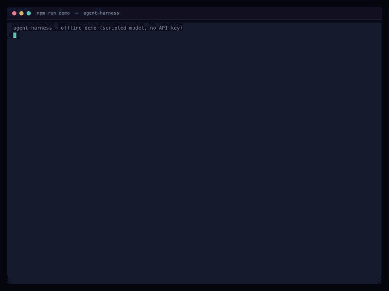
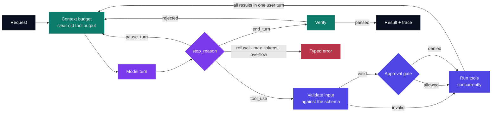

# agent-harness

[](https://github.com/Dhairya-007/agent-harness/actions/workflows/ci.yml)
[](LICENSE)
[](package.json)
[](tsconfig.json)
[](https://platform.claude.com/docs)

A small, typed agent harness for Claude.

The loop itself — ask the model, run the tools it asks for, feed the results back — is about thirty lines. Everything that makes it survive contact with a real task is the other ninety percent, and that is what this library is: **validated tool inputs, approval gates, a context budget, a verification pass, honest errors, and a trace you can read.**



<sub>`npm run demo` — runs with **no API key and no cost**. The model is scripted; the loop, the validation, the gate, the budget and the verifier are real. The script walks it into each failure on purpose: turn 2 sends arguments that miss the schema and are rejected *before the tool runs*, turn 4 tries to delete a backup and is stopped by the approval gate, turn 5 answers without naming its source and is sent back. A harness earns its keep on the turns that go wrong, so a demo of the happy path would show nothing.</sub>

```ts
import { z } from "zod";
import { Agent, defineTool } from "agent-harness";

const readFile = defineTool({
  name: "read_file",
  description: "Reads a UTF-8 text file relative to the project root.",
  input: z.object({ path: z.string() }),
  run: ({ path }) => fs.readFileSync(resolveInRoot(path), "utf8"),
});

const agent = new Agent({
  system: "You answer questions about this codebase. Cite the files you read.",
  tools: [readFile],
  budget: { maxInputTokens: 120_000 },
  verify: ({ text }) =>
    /\.\w+\b/.test(text) ? { ok: true } : { ok: false, feedback: "Cite a file." },
});

const result = await agent.run("Where does request validation happen?");
console.log(result.text, result.verified, result.usage);
```

---

## Why not just use the SDK's tool runner?

Often you should. `client.beta.messages.toolRunner()` drives the same loop, it is maintained by Anthropic, and for a straightforward custom-tool agent it is less code than this.

Reach for a harness when you need things the runner does not express:

| | SDK tool runner | agent-harness |
| --- | --- | --- |
| Runs the loop | ✅ | ✅ |
| Typed tools from Zod | ✅ | ✅ |
| Per-turn hooks | ✅ | ✅ (`onEvent`) |
| **Validates input before the tool body runs** | you do it | ✅ built in |
| **Approval gate over parsed arguments** | inside `run()` | ✅ declarative, per tool |
| **Context budget with tool-output pruning** | — | ✅ |
| **Verification pass that can send the model back** | — | ✅ |
| **Distinct errors for refusal / truncation / overflow** | — | ✅ |
| **Structured trace of the whole run** | — | ✅ |
| Server-side tools, `pause_turn` auto-resume | partial | resumes `pause_turn` |

This is ~600 lines with two dependencies. Read it in one sitting; fork it if your loop needs a different shape.

---

## How the loop is shaped



Note where the invalid and denied arrows go: **into the tool-result turn, not out of the loop.** A bad argument or a refused approval comes back to the model as `is_error: true`, and it gets to correct itself. Only the things it genuinely cannot recover from — a refusal, a tool input truncated at `max_tokens`, a context overflow — are thrown.

---

## Install

```bash
npm install @anthropic-ai/sdk zod
```

Then drop `src/` into your project, or `npm install` this package once you have published it. Node 20.11+.

Credentials resolve the way the SDK resolves them: `ANTHROPIC_API_KEY`, then `ANTHROPIC_AUTH_TOKEN`, then an `ant auth login` profile. Pass your own `client` to point at Bedrock, Vertex or Foundry, or to set retries and timeouts.

---

## The five things it does

### 1. One schema, two jobs

`defineTool` takes a Zod schema and uses it both for the JSON Schema on the wire and for validating what comes back. They cannot drift apart, because there is only one of them.

```ts
const transfer = defineTool({
  name: "transfer",
  description: "Moves money between two accounts.",
  input: z.object({
    from: z.string(),
    to: z.string(),
    amount: z.number().positive(),
  }),
  run: ({ from, to, amount }) => ledger.move(from, to, amount),
});
```

Validation before execution is not belt-and-braces. Tools are sent with `strict: true`, but with eager input streaming turned on — which this harness does whenever you stream — **the server stops validating tool input**, and the SDK's tolerant parser returns a silently truncated object rather than throwing. A tool that trusts its arguments will happily transfer `undefined`.

### 2. Approval gates that see real values

```ts
approval(input, ctx) {
  if (input.amount <= 100) return { allow: true };
  return { allow: false, reason: "transfers over $100 need a human" };
}
```

The gate runs **after** validation, so it reads typed values rather than guessing at raw JSON. A denial is not an exception — it goes back to the model as an error result, and the model routes around it ("I can't move $5,000 myself; here's the command for you to run").

### 3. A context budget

Agent transcripts are mostly tool output, and tool output stops being load-bearing once the model has acted on it.

```ts
budget: { maxInputTokens: 120_000, keepRecentResults: 4 }
```

Before each turn, the harness counts the request with `messages.countTokens` — the model's own count, never a local tokenizer, which disagrees with the server and drifts between model generations. If it is over, the oldest tool results are **emptied, not removed**: the block stays, so the `tool_use`/`tool_result` pairing the API requires survives, and only the payload is replaced with a placeholder. The most recent results are never touched, because the model is usually still reasoning about them.

### 4. A verification pass

```ts
verify({ text, messages }) {
  return text.includes("```") ? { ok: true } : { ok: false, feedback: "Show the code." };
}
```

When the model would stop, the verifier gets a look. Returning `ok: false` sends the feedback back as a user turn and the agent tries again, up to `maxVerifyAttempts` (default 1).

The verifier runs on **every** candidate answer, including the last one. `maxVerifyAttempts` caps how many times the agent is sent back — not whether the answer you finally receive was checked. `result.verified` tells you which: `true`, `false` (it ran out of attempts and this is the best it managed), or `null` (no verifier).

### 5. A trace

Every run returns an ordered list of what happened; `onEvent` streams the same events live.

```
turn_start → turn_end(tool_use) → tool_call(read_file) → tool_result(ok, 3ms)
           → turn_start → context_pruned(6 blocks, 131k→98k)
           → turn_end(end_turn) → verify(passed)
```

Events: `turn_start`, `turn_end`, `text_delta`, `tool_call`, `tool_result`, `tool_denied`, `tool_invalid_input`, `tool_unknown`, `context_pruned`, `verify`, `retry`. The trace is also attached to every `HarnessError`, which is the useful half of a bug report.

---

## Errors

Failures the harness raises itself all extend `HarnessError` and carry the trace. API failures are left as the SDK's own typed errors, so you can still tell "the model refused" apart from "we were rate limited".

| Error | When |
| --- | --- |
| `RefusalError` | `stop_reason: "refusal"`, with `category` and `explanation` |
| `ToolInputTruncatedError` | a turn hit `max_tokens` mid-tool-input |
| `ContextOverflowError` | `model_context_window_exceeded`, or pruning could not free enough |
| `MaxStepsExceededError` | the run hit `maxSteps` without finishing |
| `UnparseableToolInputError` | eager-streamed tool input never parsed, after retries |

`ToolInputTruncatedError` is the one worth dwelling on. Input cut off at `max_tokens` usually still parses as a *valid partial object* — `{"path": "src/ind` becomes `{"path": "src/ind"}`. There is no error to catch. The only safe move is to check the stop reason and refuse to run the tools from that turn.

---

## Options

```ts
new Agent({
  client,                       // your own Anthropic client
  model: "claude-opus-5-5",     // default
  system,
  tools: [],
  maxSteps: 12,
  maxTokens,                    // 16k blocking, 64k streaming
  effort: "medium",             // low | medium | high | xhigh | max
  thinkingDisplay: "summarized",
  stream: false,
  budget: { maxInputTokens, keepRecentResults, placeholder },
  verify,
  maxVerifyAttempts: 1,
  onEvent,
});

await agent.run(input, { signal, state });
```

`run` takes a string or a full `MessageParam[]`, and returns the whole conversation back, so you can continue it. `state` is a scratch object shared by every tool for the length of one run and discarded after.

### What it does and doesn't send

- **No `temperature`, `top_p` or `top_k`.** These are rejected with a 400 on current models.
- **No forced `tool_choice`.** `{type: "any"}` and `{type: "tool"}` are a 400 on Claude Opus 5.5 and Claude Sonnet 5.5. `strict: true` on every tool is what replaces the guarantee; steer with the prompt.
- **No thinking budget.** `budget_tokens` is removed; `effort` is the depth control, and on Claude Opus 5.5 thinking cannot be turned off at all. The API default there is `medium`, not `high`.
- **All parallel results in one user message.** Splitting them across messages teaches the model to stop asking for parallel calls.
- **Stable tool order.** Tools render first in the cached prefix, so insertion order is preserved and never sorted.
- **Retries belong to the SDK.** 429s and 5xxs are retried by the client (`maxRetries`, default 2); the harness does not add a second layer.

---

## Running it

```bash
npm install
npm run demo      # the GIF above — scripted model, no key, no cost
npm test          # 39 tests, no network
npm run typecheck
npm run build

ANTHROPIC_API_KEY=... npm run example:calculator
ANTHROPIC_API_KEY=... npx tsx examples/repo-qa.ts "where is the agent loop?"
```

`examples/offline-demo.ts` is the one to read first — it is the shortest path to seeing every feature fire, and it costs nothing to run.

The test suite replays scripted responses through a fake client, so it exercises the loop — parallel calls, refusals, truncation, pruning, verification send-backs, state isolation — without spending a token.

---

## A note on paths

`examples/repo-qa.ts` contains this, and it is there on purpose:

```ts
const target = path.resolve(ROOT, candidate);
const relative = path.relative(ROOT, target);
if (relative === ".." || relative.startsWith(`..${path.sep}`) || path.isAbsolute(relative)) {
  return null;
}
```

Schema validation tells you `path` is a string. It tells you nothing about where the string points. A path from the model is untrusted output, and `../../.ssh/id_rsa` is a perfectly valid string. Confine it to a root before you open it. The check above is lexical — if your root can contain symlinked directories, canonicalize with `fs.realpath` as well.

---

## License

MIT © Dhairya Oza
